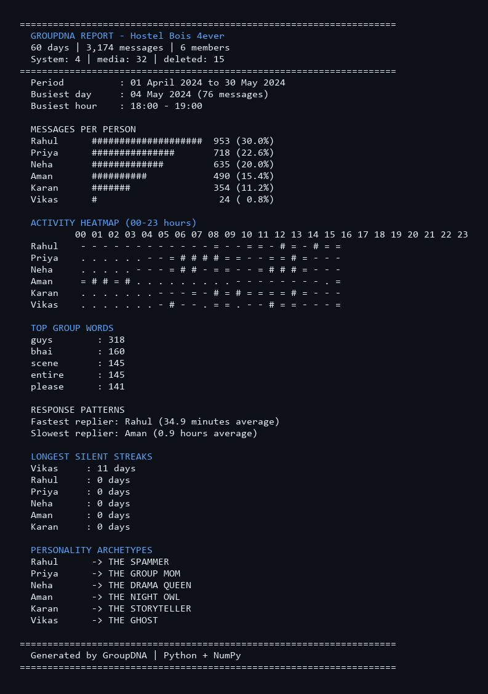

# GroupDNA - WhatsApp Group Chat Analyzer

GroupDNA reads the supplied synthetic WhatsApp export for “Hostel Bois 4ever” and creates a compact activity and personality report. This project applies Python fundamentals and NumPy to a realistic text-cleaning and analysis task.

## What the notebook does

- Parses timestamped WhatsApp messages and handles system events, media placeholders, deleted messages, blank lines, and continuation lines.
- Summarizes participants, message counts, date range, busiest day, and busiest hour.
- Counts frequent words using a manually built dictionary counter and a configurable stop-word list.
- Builds a NumPy participant-by-hour activity matrix and renders it as a text heatmap.
- Calculates response gaps and each participant's longest silent streak.
- Scores participants against the assignment's personality archetypes and prints a formatted report.

## What I understood

The assignment is about more than counting messages. The raw export contains system notices and special message types, so the parser must separate those from normal text and preserve the right information for different metrics. The analysis must be built with loops, dictionaries, sets, string operations, file I/O, datetime, and NumPy. It must not rely on pandas, plotting packages, regular expressions, `Counter`, or a prebuilt chat analyzer. The final output is itself part of the deliverable: it should make the findings easy to read and screenshot.

## What I solved

The notebook is organized as a sequence of the eight required features: parsing, group overview, activity peaks, NumPy heatmap, top words, response and silence patterns, archetypes, and the final report. Media and deleted entries remain in message activity totals and receive their own counters; they are excluded from content-word and message-length analyses. The parser tracks system messages separately and can join timestamp-free continuation lines to the preceding record.

## Files

- `GroupDNA_Umar_NoRollNumberProvided.ipynb` - the Colab/Jupyter notebook (The brief did not provide the student roll number, so the filename marks that as unavailable.)
- `hostel_bois.txt` - the synthetic dataset supplied with the assignment.

## Run it

1. Open the notebook in Google Colab or Jupyter.
2. Upload or place `hostel_bois.txt` in the same session/directory.
3. Run all cells from top to bottom. If needed, change `FILE_PATH` in Feature 1.
4. Your name, batch, date, and “Not issued” roll-number note are filled in. Complete the reflection cell before submission.

## Constraints and disclosure

Only Python fundamentals, NumPy, and the limited `datetime` operations described in the brief are used. No pandas, matplotlib/seaborn/plotly, regex, `collections.Counter`, `defaultdict`, machine-learning libraries, or chat-analysis packages are used. AI assistance was used to draft portions of the notebook; the code and explanations should be reviewed and adapted by the student before submission, and the required disclosure is included in the notebook.

## Current submission status

The notebook was run end-to-end against the supplied dataset, and the screenshot above shows its report. It parsed 3,174 user messages from 6 participants, with 4 system events, 32 media records, and 15 deleted-message records. The supplied file gives Vikas 16 active days and the other five participants 60 active days each; this differs from some example silent-streak values in the brief, so the notebook reports the dates calculated from the supplied data. The roll number was not provided to the student, so the notebook filename marks it as unavailable.

